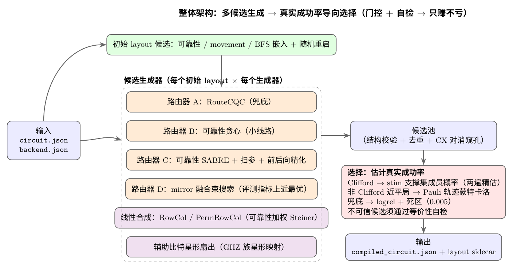

# Noise-Adaptive Quantum Compiler

**2nd place — CCF 2026 Noise-Adaptive Quantum Compilation Challenge (algorithm track).**

A qubit mapping and routing compiler for NISQ devices that does not optimize a proxy metric
(SWAP count, circuit depth, or estimated log-reliability). Instead it **generates many candidate
compilations and selects among them by estimating the true noisy success rate** — cheaply, and
without ever looking at the expected answer.

| | Track A | Track B | Final |
|---|---:|---:|---:|
| Official `RouteCQC` baseline | 0.7583 | 0.4062 | 0.6703 |
| **This work** (seed 7) | **0.8647** | **0.5693** | **0.7909** |
| This work (10-seed mean) | 0.8654 | 0.5684 | 0.7911 |

**+18.0% over the official baseline**, 10/10 public benchmarks valid. The simulator is seeded, so
every number above reproduces **bit-for-bit** with the commands in [Reproducing the results](#reproducing-the-results).

[中文说明见 README_zh.md](README_zh.md) · [完整方法文档 (PDF)](submission/docs/solution_zh.pdf)

---

## The problem

A compiler is invoked as a black box:

```bash
compiler --circuit circuit.json --backend backend.json --out compiled_circuit.json
```

It must map a logical circuit onto a noisy device's physical qubits and coupling graph, emit a
Cirq JSON circuit plus a layout sidecar, pass a hidden non-noisy equivalence check, and is then
scored by `success_rate = correct_shots / total_shots` under a gate-local depolarizing +
readout-error model. Track A uses Cirq density-matrix sampling on general circuits (weight 0.75);
Track B uses Stim on large Clifford stress circuits (weight 0.25).

## Approach



### 1. Candidate generation — a portfolio, not a pipeline

No single strategy wins on every circuit, so six generators run in parallel against every candidate
initial layout, and anything that fails structural validation is silently dropped:

- **RouteCQC** (Cirq's lookahead router) — plus a bare-layout instance as a safety fallback
- **Reliability-weighted greedy** routing along most-reliable shortest paths (small circuits)
- **Reliability-weighted SABRE** with forward-backward initial-mapping refinement and a
  (metric × lookahead weight × window) parameter sweep
- **Beam-search router with mirror fusion** — the main Track A contribution (below)
- **Topology-aware linear synthesis**: RowCol and **PermRowCol** over GF(2), with
  reliability-weighted Steiner trees and region growth
- **Ancilla-assisted star fan-out** for GHZ-family maps, using spare qubits as pure-copy carriers

### 2. Beam-search routing with mirror fusion

SABRE and RouteCQC are greedy: one SWAP at a time, no backtracking. The beam search keeps the best
100 partial routings over states of (current mapping, executed-gate set), and minimizes **exactly
the evaluator's log-reliability objective** — per-edge CX costs, single-qubit gate costs, and the
readout error of the final measured positions. Two details matter:

- **Mirror fusion.** Executing `cx(a,b)` and then swapping that pair is `cx(b,a); cx(a,b)` — **2 CX,
  not 1+3**. Making "execute while relocating" a first-class move cut CX counts across the board:
  toffoli 9→8, fredkin 14→11, peres 13→9, or 12→8, adder 27→23, structured-random 34→23, parity 106→88.
- **The heuristic must sum over *all* unexecuted two-qubit gates**, not just ready ones. Otherwise a
  sequential dependency chain (GHZ fan-out) makes lagging states permanently cheaper than advanced
  ones and the beam stalls — a bug we hit and fixed.

### 3. Selection by estimated true success rate

Log-reliability assumes every physical error is fatal. It is not: on the parity benchmark
`exp(logrel) = 0.17` while the measured success rate is `0.44`. The gap is entirely **harmless
errors**, and exploiting it is the main Track B contribution:

- **Clifford circuits → affine-support membership.** The noiseless output distribution of a Clifford
  circuit on `|0…0⟩` is uniform over an affine GF(2) subspace, and the competition's scoring rules
  (`bitstring`, `allowed_bitstrings`, `parity_checks`) are *exactly* membership tests for that
  subspace. So `P(noisy stim sample stays inside the noiseless support)` is a **rule-free, unbiased
  estimate of the real score** — and the support is rebuilt from the candidate circuit itself
  (256 noiseless samples → GF(2) elimination → basis; then 4096 noisy Stim samples), never from the
  expected answer. Milliseconds per candidate. Top candidates get a higher-precision second pass.
- **Non-Clifford circuits → Pauli-trajectory Monte Carlo.** Depolarizing noise is a stochastic Pauli
  channel, so trajectory statevector simulation is exact in distribution. Near-ties (within 0.025
  logrel of the best) are re-ranked with 400 trajectories, readout marginalized analytically and
  variance reduced by conditioning on ≥1 fault.
- **Deadband fallback.** When neither estimator applies, logrel decides — but an untrusted candidate
  must win by ≥0.005 before it replaces a trusted one. Sub-resolution logrel "improvements" are pure
  variance; across 10 seeds, churning on them is net negative.

One subtlety worth flagging: whether to use the Clifford machinery is decided **by the circuit, not
by the backend's basis gates**. The large backend's basis contains `t`/`rz`, so a backend-based test
silently disabled the entire Clifford path — a real bug, and fixing it was worth +0.024 Final.

Every untrusted candidate must additionally pass an internal equivalence self-check before it can be
selected (exact Stim support comparison for Clifford circuits, exact histograms otherwise).

## Reproducing the results

Python 3.11+ required.

```bash
python -m venv .venv && . .venv/bin/activate     # Windows: .venv\Scripts\activate
python -m pip install -e '.[dev]'

# Full public-set evaluation — expect A=0.8647  B=0.5693  Final=0.7909
nah-evaluate-submission --root . --shots-a 256 --shots-b 1024 --seed 7 \
  --out results/my_summary.json \
  --command "$(pwd)/.venv/bin/python" "$(pwd)/submission/compiler.py"

# Official baseline for comparison — expect Final=0.6703
nah-evaluate-submission --root . --shots-a 256 --shots-b 1024 --seed 7 \
  --out results/baseline_cqc.json \
  --command "$(pwd)/.venv/bin/python" -m noise_adaptive_hackathon.cli.run_baseline --compiler cirq_cqc
```

> The evaluator runs the submission in an isolated temporary directory, so both the interpreter and
> the script in `--command` **must be absolute paths** — otherwise the subprocess may resolve to a
> system Python without the dependencies and every sample scores zero.

Windows users: see [`submission/docs/windows_setup_zh.md`](submission/docs/windows_setup_zh.md) or run
[`run_checks.bat`](run_checks.bat), which creates the environment, evaluates both compilers and prints
the comparison.

Other entry points:

```bash
PYTHONPATH=src python submission/scripts/generate_compiled_outputs.py  # per-benchmark compiled outputs
PYTHONPATH=src python submission/scripts/test_linear_synth.py          # GF(2) synthesizer regression (600×2 random cases)
bash submission/scripts/run_public_eval.sh                             # this submission + both baselines
python submission/scripts/analyze_results.py                           # comparison table + figures
python -m pytest -q                                                    # upstream regression suite (26 tests, ~3 min)
```

## Repository layout

```text
submission/              ★ this work
├── compiler.py              the submitted black-box compiler
├── scripts/                 batch compilation, evaluation, analysis, regression tests
├── docs/                    method write-up (zh, md + pdf), Windows guide, figures (+ TikZ source)
└── results/                 evaluation JSONs, ablation, 10-seed robustness, per-sample outputs

src/ benchmarks/ backends/   official competition harness (evaluator, simulators, public benchmarks,
docs/ examples/ formats/     device snapshots, baselines) — MIT, © 2026 SpinQ Technology
tests/ pyproject.toml        bundled verbatim so the repository reproduces out of the box
```

## Results detail

Ablation, per-sample success rates, and 10-seed robustness are in
[`submission/results/`](submission/results/); the full method write-up, including negative results
(KAK re-synthesis, ancilla-assisted Steiner-Gauss for parity, Paar-style common-subexpression
factoring) and limitations, is in [`submission/docs/solution_zh.pdf`](submission/docs/solution_zh.pdf).

| Stage | Track A | Track B | Final |
|---|---:|---:|---:|
| RouteCQC baseline | 0.758 | 0.406 | 0.670 |
| + multi-candidate layouts + reliability selection | 0.845 | 0.443 | 0.745 |
| + topology-aware linear synthesis (GHZ) | 0.845 | 0.484 | 0.755 |
| + reliability-weighted SABRE | 0.847 | 0.493 | 0.759 |
| + SABRE forward-backward refinement | 0.853 | 0.520 | 0.769 |
| + beam search / PermRowCol / deadband | 0.854 | 0.531 | 0.774 |
| + mirror fusion + trajectory-MC re-ranking | 0.865 | 0.531 | 0.781 |
| + support-membership selection + star fan-out | 0.865 | 0.548 | 0.786 |
| + fan-out weight sweep + wider beam seeding | **0.865** | **0.569** | **0.791** |

## License and attribution

This repository is MIT licensed. `submission/` is original work; the competition harness at the
repository root is redistributed under its own MIT license (© 2026 SpinQ Technology) — see
[`NOTICE.md`](NOTICE.md) and [`THIRD_PARTY_NOTICES.md`](THIRD_PARTY_NOTICES.md).

Third-party methods this work builds on: SABRE (Li, Ding & Xie, ASPLOS'19), Cirq `RouteCQC`,
and RowCol / PermRowCol from the CNOT-circuit synthesis literature.
