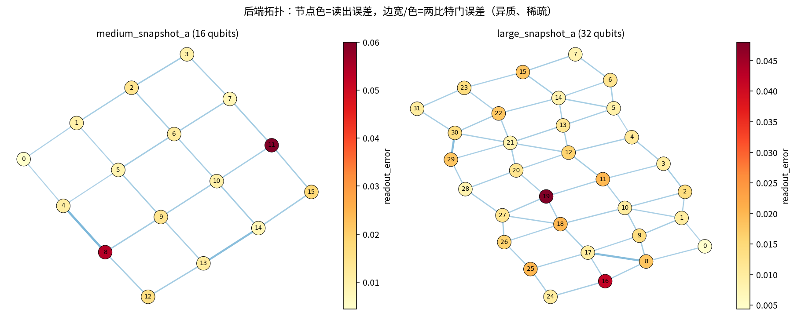
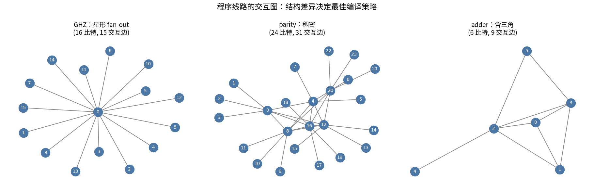
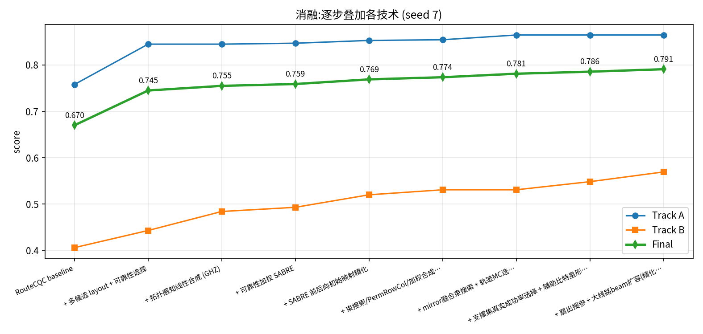
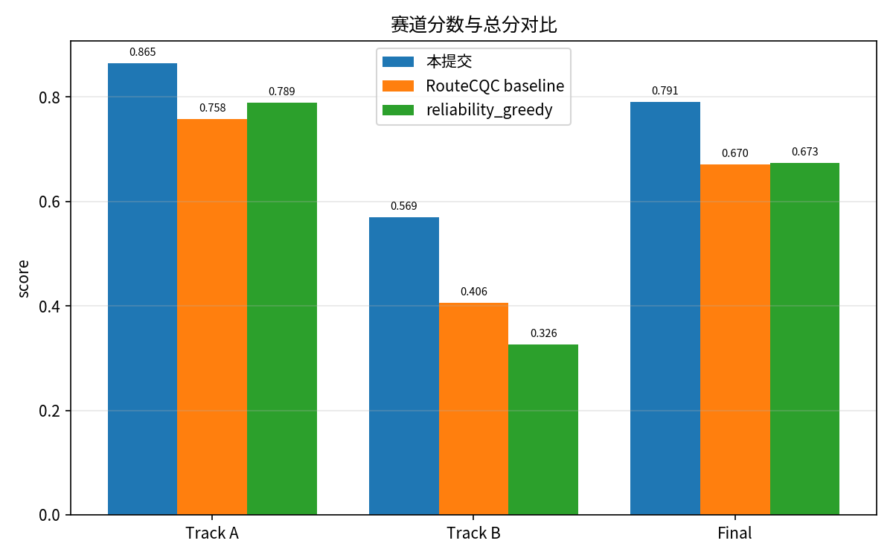
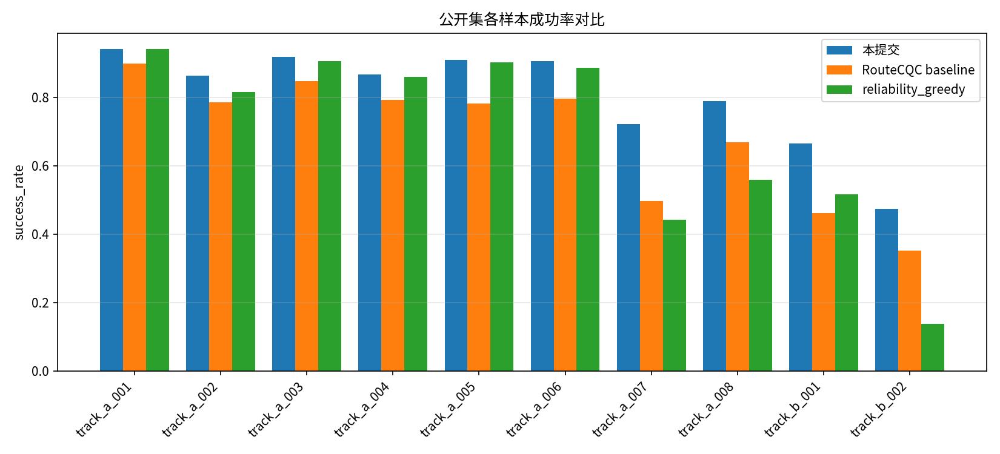

# 噪声自适应量子编译挑战 — 解决方案

说明文档-作者：Nigma

日期：2026-07-03

### 一、赛题背景:

本赛题是一个面向中等规模含噪量子计算机（NISQ）的**量子编译映射**问题。参赛程序作为**黑盒命令**被评测器调用，只接收三个参数：

```bash
your-compiler --circuit circuit.json --backend backend.json --out compiled_circuit.json
```

程序须把输入逻辑线路映射到给定硬件后端的物理比特与耦合图上，输出编译后的 Cirq JSON 物理线路
`compiled_circuit.json`，以及同目录下描述"每个程序比特初始物理位置"的 layout sidecar
`compiled_circuit.layout.json`。评测在**保持无噪语义等价**的前提下，用带噪采样的正确输出概率打分：

$$
\text{success\_rate} = \frac{\text{correct\_shots}}{\text{total\_shots}}, \qquad
\text{Final Score} = 0.75 \times \text{TrackA} + 0.25 \times \text{TrackB}.
$$

带噪评分之前，会依次进行四道**无噪**检查，任一失败该样本记 $0$ 分：**(1)** 结构校验（门在
`basis_gates` 内、两比特门落在 `coupling_map` 上、测量为最终 $Z$ 测量、无中途测量/reset/feedforward；
Track B 必须为 Clifford 子集）；**(2)** layout sidecar 校验；**(3)** 隐藏的 compiler-equivalence 检查
（用 sidecar 在源线路与编译线路前插入相同的隐藏初态扰动，比较无噪输出分布，以防"直接准备答案"）；
**(4)** 无噪语义检查。

比赛分两条赛道：**Track A**（8 个通用 NISQ 样本，Cirq density-matrix 采样，支持通用门集，权重 0.75）；
**Track B**（2 个大规模 Clifford 压力样本 GHZ/parity，Stim 采样，必须 Clifford-only，权重 0.25）。

本团队的解决方案核心是：**不押注单一编译流水线，而是并行生成多种候选编译，再用尽可能接近
"真实带噪成功率"的目标函数择优**。在公开集上把官方 RouteCQC baseline 的总分从 $0.670$ 提升到
稳健均值 $0.791$（约 **+18.0%**），且所有样本合法。

### 二、运行环境:

- 操作系统：Linux (Ubuntu 22.04)，纯 CPU；另在 **Windows 10/11 + Python 3.12** 完整复现通过
  （见仓库根目录《submission/docs/windows_setup_zh.md》）。
- Python：官方要求 3.11+；本作品在 3.10/3.12 上开发评测（源码仅用 `from __future__ import annotations`，
  行为与 3.11+ 一致）。依赖与 `pyproject.toml` 一致：`cirq>=1.5`、`networkx>=3.2`、`numpy>=1.26`、
  `pydantic>=1.10,<3`、`stim>=1.15`、`stimcirq>=1.15`（实测 cirq 1.5.0/1.7.0，stim 1.16.0）。
- 单条线路编译 $\le 19$ 秒（低于 30 秒/样本超时，大线路的生成预算另行收紧以保证慢机余量），
  且**确定可复现**（同输入两次运行输出逐字节一致）。
- 评测参数：`--shots-a 256 --shots-b 1024 --seed 7`。

### 三、噪声模型分析与优化目标:

后端只含三类 gate-local 噪声，按对成功率的影响排序：

1. **两比特门 depolarizing**：每条耦合边有独立错误率 $p_{\text{edge}} \in [0.0055, 0.065]$，
   一次 `cx` 后接 $\mathrm{DEPOLARIZE2}(p_{\text{edge}})$。它**远大于**单比特误差。由于一个额外 SWAP 要
   分解成 $3$ 个 `cx`，routing 开销会平方级地侵蚀成功率。
2. **读出 bit-flip**：每个物理比特有独立 $r_q \in [0.0044, 0.06]$，测量前施加 $X\_ERROR(r_q)$，
   与物理位置强相关。
3. **单比特门 depolarizing**：全局 $p_1 = 0.001$，很小但**非零**（后文的负结果会用到这一点）。

公开 v1 模型**不含** idle noise、crosstalk、leakage、脉冲调度、drift 或方向相关 CNOT 误差。因此
（正如官方提示）优化重点应放在 **比特选择、routing 路径、两比特门数量**，而非脉冲或时间排布。

下图直观展示了两个后端的拓扑：**稀疏**（度 $\le 4/6$）、且读出误差（节点色）与两比特误差（边宽/色）
**高度异质**——这正是"把关键比特放到低误差区域、让两比特门走可靠边"能提分的根本原因。



一个统一、可计算、且**不依赖期望答案**的成功率代理指标（评测器也会报告它）是**估计对数可靠度**：

$$
\text{logrel}(C) = \sum_{g \in \text{1q}} \log(1-p_1)
                 + \sum_{g \in \text{cx}} \log\!\big(1-p_{\text{edge}(g)}\big)
                 + \sum_{q \in \text{measured}} \log(1-r_q).
$$

它把每个门的真实错误率与每个被测比特的读出误差都计入，是我们做候选择优的核心目标函数。

### 四、总体方法：多候选生成 + 可靠度选择:

对 benchmark 的结构分析表明**没有单一策略在所有线路上最优**。下图给出三类代表线路的交互图：
GHZ 是**星形** fan-out，parity **稠密**，adder 含**三角**子结构——它们对 layout 与 router 的敏感度
截然不同。



实测两个现成 baseline 恰好互补：`reliability_greedy`（好 layout + 朴素逐门 router）在小线路上很强
（$0.85\!-\!0.94$），但稠密线路 router 爆炸（parity 路由出 $238$ 个 `cx`）；Cirq `RouteCQC`（前瞻
router）稠密线路更好，但初始 layout 不感知读出/可靠性。

**因此本方案采用"多候选生成 + 统一择优"的架构**（下图）：对每种"初始 layout × 路由器"组合各生成
一个候选编译，保留通过结构校验者，最后按赛道择优——Track A 用 $\text{logrel}$（带死区，见 4.7），
Track B 用真实成功率的支撑集估计（见 4.7）——并输出最优者的 sidecar。


该设计有三个关键性质：**(a) 不过拟合**——选择指标只依赖后端错误率与线路本身，从不读取期望答案，
故隐藏等价性检查天然通过，且对未见的 hidden benchmark 同样有效；**(b) 只赚不亏**——新增任何候选
生成器都只可能提供更优解，更差或非法者被自动忽略；**(c) 鲁棒**——始终含一个裸 RouteCQC 兜底。

#### 4.1 初始 layout 生成:

生成多个候选映射 logical→physical：库内的 `reliability_layout`（可靠度加权 Steiner 距离）与
`movement_aware_layout`（交互图-硬件图移动代价）；外加自实现的**可靠性感知 BFS 嵌入**——以"低读出 +
高度数 + 邻接低误差耦合器"排序选出若干物理 hub 作种子，把交互度最高的逻辑比特放到 hub，随后按
"与已放置集合的加权连接强度"贪心地为每个逻辑比特选取使 $\sum_j w_j\,e^{-d_{\text{rel}}}$ 最大、
读出最优的物理位。所有 layout 补全到覆盖全部程序比特（孤立比特放到读出最好的空闲位）。

#### 4.2 路由器 A：Cirq RouteCQC:

用 `cirq.RouteCQC` + `HardCodedInitialMapper` 把候选 layout 强制为初始映射，SWAP 分解为 `cx`。
前瞻式 SWAP 插入，稠密线路上 `cx` 数较优，但**不感知错误率**。另保留一个不指定初始映射的裸
RouteCQC 兜底。

#### 4.3 路由器 B：可靠性加权贪心:

仅对 $\le 12$ 比特线路启用：逐个两比特门，沿**可靠度加权最短路**（$\text{cost}=-\log(1-p_{\text{edge}})$）
把两端靠拢并 SWAP。对小/稀疏线路很强，对稠密线路会爆炸，故限制规模。

#### 4.4 路由器 C：可靠性加权 SABRE 与前后向精化:

Cirq 的 RouteCQC 完全不看边误差。我自实现了一个 **SABRE 路由器**，把启发式中的"距离"替换为
**可靠度加权代价**，从而在深度相近时**优先走低误差耦合器**：维护 front 层（DAG 中前驱已执行的门），
反复执行可直接执行的门；无可执行门时，在与 front 中两比特门相关的候选 SWAP 上最小化启发式
$H = \mathrm{mean}_{g\in F} D[\pi(g)] + W\cdot \mathrm{mean}_{g\in E} D[\pi(g)]$（$D$ 为可靠度距离或
跳数，$E$ 为前瞻集，附带 decay 惩罚与"可靠边优先"平局规则），施加最优 SWAP 并更新映射。

在此基础上实现了标准 SABRE 的关键步骤——**前后向初始映射精化**：给定初始 layout，交替对线路做
"正向路由 → 以其末态映射为起点 → 反向路由 → 再取其末态映射"若干轮，把初始映射**退火**到需要更少
SWAP 的位置。由于 SABRE 路由极快（parity 单次约十几毫秒），我们从**所有候选 layout + 若干随机重启**
出发各跑一次精化+路由，取可靠度最优者；随机重启增加多样性，对未见稠密线路更稳健。

30 秒超时预算此前只用了不到一半，因此进一步做**参数扫描**：每个初始映射分别用 hop/rel 两种度量
精化，再对 (距离度量 $\times$ 前瞻权重 $W\in\{0.3,0.5,0.8\}$ $\times$ 前瞻窗口 $\{20,40\}$) 的组合
各路由一次，所有产物去重后进入候选池——单条线路数百次路由仍远在预算之内。

实测（同一初始 layout，精化前→后）：track_a_007 $27\!\to\!24$ 个 `cx`、track_a_008 $25\!\to\!22$、
parity $121\!\to\!106$；**parity 的 $\text{logrel}$ 从 $-1.942$ 提到 $-1.845$**，成功率 $0.371\to0.424$。

> 一个隐蔽的正确性坑：SABRE 的 sidecar 必须写 routing **之前**的初始映射，而非之后的最终映射——
> 写错会让隐藏等价性检查整条线路判 $0$（我们踩过并修复，且加了运行时等价性自检兜底，见 4.7）。

#### 4.5 路由器 D：束搜索 + mirror 融合（近最优 SWAP 插入）:

SABRE/RouteCQC 都是**贪心**：每次只提交一个 SWAP，无法回头。本方案实现**束搜索**路由：状态为
（当前映射，已执行门集合），单比特门强制执行，两比特门阻塞时对候选 SWAP 分支（代价 $3\times$
边代价），按"已付代价 + 全体未执行两比特门的可靠度距离"保留最优的 $100$（大线路 $40$）个部分解。
完成态的总代价**恰为评测器的 $-\text{logrel}$**（含单比特门与**最终测量位置的读出项**），即束搜索
直接在评测指标上做近似最优化。产物与 SABRE 同池，须通过等价性自检方可入选。

两个关键设计：**(a) mirror 融合**——执行 `cx(a,b)` 后立刻交换该对，等价于序列
`cx(b,a); cx(a,b)`，共 $2$ 个 `cx` 而非 $1+3$；把"边执行边搬运"变成一等公民操作后，
几乎所有样本的 `cx` 数进一步下降（toffoli $9\to8$、fredkin $14\to11$、peres $13\to9$、
or $12\to8$、adder $27\to23$、structured_random $25\to23$）。**(b) 启发式必须统计全部未执行
两比特门**（而非只统计就绪门），否则 GHZ 这类**顺序依赖链**会让落后状态永远比先进状态"便宜"，
束搜索原地打转（我们踩过该坑）。加宽束（$300$）与更多种子不再改善，说明已达该目标函数下的
路由收益平台。

#### 4.6 Track B：拓扑感知线性合成 (RowCol / PermRowCol / Steiner-Gauss):

**关键洞察**：Track B 的 GHZ、parity 都是"前缀 $H$ 层 + GF(2) 线性核（`cx`/`x`）"结构，而**两个实现
同一 GF(2) 线性映射的 CNOT 电路作为酉算子完全相等**。因此可抛开"逐门+SWAP 路由"，直接对线性核做
受连通性约束的 CNOT 合成：

先把线性核累积成矩阵 $A$（$n\times n$，GF(2)）与常数向量 $b$，满足 $\text{output} = A\mathbf{x} \oplus b$
（`cx(c,t)`：$A_t \mathrel{\oplus}= A_c,\ b_t \mathrel{\oplus}= b_c$；`x(q)`：$b_q \mathrel{\oplus}= 1$）。
再在后端选一块**连通的低读出区域**并给出映射，用 **RowCol** 算法合成实现 $A$ 的 CNOT 网络：
逐顶点（取当前剩余图中的非割点）先做**列消元**（用 Steiner 树把该列聚成单个 $1$）、再做**行消元**
（GF(2) 线性求解要相加的行集合，用 Steiner 树的"扇出转置"实现），随后从图中删去该顶点；常数 $b$ 用
末尾单比特 $X$ 实现，前缀 $H$ 照搬到映射位。**严格自检**：对合成电路重建 GF(2) 映射并断言与 $A$ 完全
相等，不过则丢弃；该合成器另用 $600\times2$ 组随机可逆矩阵/随机连通图做过正确性回归
（`submission/scripts/test_linear_synth.py`）。

在 RowCol 之上再做三个升级：**(i) PermRowCol**——RowCol 强制"输出行 $k$ 终止于区域节点 $k$"，
PermRowCol 把每步消元的（顶点，输出行）配对改为贪心选择，即电路只需实现 $A$ 的**行置换版本**，
置换被**初始映射吸收**（输入放置改为 $\sigma^{-1}$，输出/测量位置不动），稀疏拓扑上通常显著省
`cx`；**(ii) 可靠性加权**——列/行消元里的最短路与 Steiner 树可按边代价 $-\log(1-p_{\text{edge}})$
加权，让合成网络优先走低误差耦合器；**(iii) 区域选择**——除"低读出优先"外增加"低边误差优先"的
区域生长模式（合成网络对区域**边**的复用远多于对读出的使用）。所有变体仍逐一通过严格的
GF(2) 矩阵自检（置换版本验证 $C[k][\sigma^{-1}(j)]=A[k][j]$），不过则丢弃。

效果：GHZ 从路由的 $39$ 个 `cx` 降到 RowCol 合成的 $28$ 个（成功率 baseline $0.461 \to 0.615$）；
升级后的合成器给出更优候选（logrel $-0.556 \to -0.520$），GHZ 10-seed 平均 $0.619 \to 0.637$。
parity 的线性映射在这块稀疏拓扑上 Steiner 复杂度过高（合成 $200+$ 个 `cx`，反不如路由/束搜索），
故对 parity **自动回退**——正体现"门控候选"的价值。

**辅助比特星形扇出（GHZ 家族的最终方案）**：星形映射 $\text{out}_i = x_i \oplus x_r$ 有一个
路由/区域合成都拿不到的自由度——**空闲物理比特**。空闲比特初态恒为 $|0\rangle$，故
`cx(carrier, spare)` 把根值**纯净复制**到 spare 上，使其成为新的本地"载体"；每个叶子只需从
最近载体接一次 `cx`。骨干复制走全后端**最优边**（不再被挤在 $n$ 比特区域里），且骨干上的错误
对下游表现为**整体翻转**——对 GHZ 判分基本无害，正好被 4.7 的支撑集估计所奖励。构造上落点
优先吃"死胡同"节点并做连通性检查（否则前几个叶子会把根的通路封死）。该候选属**不可信池**，
必须通过等价性自检（隐藏检查会在 sidecar 位置注入挑战态，扇出结构天然等价）。
效果：GHZ $29 \to 25$ 个 `cx`，10-seed 平均 $0.637 \to 0.661$（合计较 RowCol 首版 $+0.046$）。
落点评分的(距离,读出)权重另做小规模搜参，多组变体全部交给支撑集估计择优。

#### 4.7 选择指标：尽可能逼近真实成功率:

$\text{logrel}$ 是好代理但有盲区：它假设**所有**错误都致命，而实际上"无害错误"占比可观
（GHZ 的整体翻转、不经过后续 $H$ 的 $Z$ 错误等；b_002 上 $\exp(\text{logrel})=0.17$ 而实测
成功率 $0.44$）。最终选择逻辑按线路类型分层：

1. **Clifford 线路（按线路判定，与赛道无关）→ 支撑集成员概率估计**：Clifford 线路在
   $|0\rangle^{\otimes n}$ 上的无噪输出分布均匀支撑在一个 GF(2) **仿射子空间**上，而比赛判分规则
   （bitstring / allowed_bitstrings / parity_checks）恰是该子空间的成员测试。因此"带噪样本仍落在
   无噪支撑集内的概率"就是真实成功率的无偏估计，且**完全不读期望答案**（支撑集由候选线路自身采样
   重建：256 个无噪样本做 GF(2) 消元得基底，再对 4096 个带噪 stim 样本查成员归属，毫秒级）。
   对前 $8$ 名再以 $4$ 倍 shots 复估求均值，把选择分辨率提高到 $\sim 0.3\%$。
   一个实战教训：track 不能只看后端 basis——大后端 basis 含 `t`/`rz`，若按后端判定,
   GHZ/parity 会被当作通用线路而错过整套 Clifford 工具链；应按**线路本身是否 Clifford** 判定
   （对恰好是 Clifford 的 Track A 样本如 BV，该估计退化为精确成功概率，同样适用）。
2. **非 Clifford 小线路 → 轨迹蒙特卡洛精排**：depolarizing 是随机 Pauli 信道，可用"采样 Pauli
   故障 + statevector 轨迹"**精确按分布**模拟真实成功率（读出解析边缘化；条件于"至少一个故障"
   做方差缩减，$400$ 条轨迹分辨 $\sim0.5\%$）。对 logrel 相差 $<0.012$ 的头部候选（≤6 个）做
   精排——它们的 logrel 平局/微差恰恰是"无害错误结构"不同之处。
3. **兜底死区（deadband）**：以上估计不可用时（输出非确定、活跃比特过多），退回 logrel 择优,
   且不可信候选必须以 $\ge 0.005$ 的优势超过可信候选才会替换——多 seed 实验证明低于该分辨率的
   logrel"改进"换候选纯属方差。

对不可信候选（SABRE/束搜索/星形扇出），入选前必须通过**内部等价性自检**。Clifford 情形改用
**stim 支撑集精确比较**（stabilizer 测量分布 = 支撑集上的均匀分布，支撑集相等 $\Leftrightarrow$
分布相等）——比原来的 512-shot 采样 TV 比较**更严格且快两个数量级**，把 parity 的编译总时长
从 $20$ 秒压回 $15$ 秒；非 Clifford 小线路仍用精确直方图比较。由此从算法与工程两层保证
"选入的候选一定等价"。

### 五、消融实验与结果:

逐步叠加各技术，每一步都是**通用**方法（无任何针对公开样本的硬编码），提升可迁移至 hidden benchmark：



| 阶段 | Track A | Track B | Final |
|---|---:|---:|---:|
| RouteCQC baseline | 0.758 | 0.406 | 0.670 |
| + 多候选 layout + 可靠性选择 | 0.845 | 0.443 | 0.745 |
| + 拓扑感知线性合成（GHZ） | 0.845 | 0.484 | 0.755 |
| + 可靠性加权 SABRE | 0.847 | 0.493 | 0.759 |
| + SABRE 前后向初始映射精化 | 0.853 | 0.520 | 0.769 |
| + 束搜索/PermRowCol/加权合成 + 死区 | 0.854 | 0.531 | 0.774 |
| + mirror 融合束搜索 + 轨迹 MC 精排(A) | 0.865 | 0.531 | 0.781 |
| + 支撑集真实成功率选择 + 辅助比特星形扇出(B) | 0.865 | 0.548 | 0.786 |
| + 扇出搜参 + 大线路束搜索扩容(精化种子×2度量) | **0.865** | **0.569** | **0.791** |

公开集（seed 7）与两个内置 baseline 的对比，以及各样本明细：



| 样本 | 本提交 | RouteCQC | reliability_greedy | `cx` | 选中方法 |
|---|---:|---:|---:|---:|---|
| track_a_001 | 0.941 | 0.898 | 0.941 | 2 | layout+RouteCQC |
| track_a_002 | 0.863 | 0.785 | 0.816 | 8 | SABRE(扫参) |
| track_a_003 | 0.918 | 0.848 | 0.906 | 8 | 束搜索(mirror) |
| track_a_004 | 0.867 | 0.793 | 0.859 | 11 | 束搜索(mirror) |
| track_a_005 | 0.910 | 0.781 | 0.902 | 9 | 束搜索(mirror) |
| track_a_006 | 0.906 | 0.797 | 0.887 | 8 | 束搜索(mirror) |
| track_a_007 | 0.723 | 0.496 | 0.441 | 23 | 束搜索(mirror) |
| track_a_008 | 0.789 | 0.668 | 0.559 | 23 | 束搜索(mirror) |
| track_b_001 (ghz) | 0.665 | 0.461 | 0.516 | 25 | 辅助比特星形扇出 |
| track_b_002 (parity) | 0.474 | 0.352 | 0.137 | 88 | 束搜索(mirror)+支撑集选择 |



### 六、稳健性（多 seed 均值）:

单次评测存在采样噪声（每样本 $\text{std}\approx 0.013\!-\!0.030$，弱样本如 track_a_007 单 seed 可在
$0.69\!-\!0.81$ 波动）。用 seed $7\!-\!16$ 共 10 次评测取均值（`submission/results/robustness_10seed.json`）得到
更稳定的估计：

| 指标 | 10-seed 均值 |
|---|---:|
| Track A | 0.865 |
| Track B | 0.568 |
| **Final** | **0.791** |

即稳定期望总分约 **$0.791$**，相对 baseline $0.670$ 提升约 **+18.0%**，公开集 **10/10 全部合法**。
与改进前版本在**同一环境**下逐样本对比（各跑 10 seed），增益全部非负：
track_b_002 $+0.051$、track_b_001 $+0.042$、track_a_008 $+0.039$、track_a_007 $+0.020$、
track_a_005/006 $+0.017$、track_a_004 $+0.010$，其余样本持平（死区避免了无谓的候选更换）。

### 七、已探索但未采用的方向（负结果）:

为避免过拟合、并确认已接近该噪声模型的实际上限，我系统性实现并测试了多条路线，均因**无净收益**
被门控机制淘汰（记录于此以示严谨）：

1. **parity 的带辅助比特线性合成**：把 $24\times24$ 映射嵌入 $32\times32$（8 个空闲比特作 Steiner 辅助）
   全图合成，得 $217$ 个 `cx`，远不如 SABRE 的 $106$——parity 线性映射在度 $\le6$ 稀疏拓扑上 Steiner
   复杂度本质偏高。
2. **两比特块 KAK 重合成 / 原生门族合成**：这是最被寄予期望的一条路，但经决定性实验被否定。
   Track A 的 toffoli/fredkin/peres/or/adder 实际是 $4\!-\!6$ 比特、含 $T$ 的**非 Clifford** 线路，
   并非可直接替换的单个三比特门（toffoli 已被 SABRE 精化解到 $9$ 个 `cx`/成功率 $0.922$）；而对多
   比特非 Clifford 酉阵做拓扑感知的最优合成本身是难解的。唯一可行的是块级 KAK 重合成：它确能降两
   比特门（track_a_007 $27\to23$），但**本模型下单比特门非免费**（$p_1=0.001$），KAK 引入大量单比特
   旋转，实测**真实带噪成功率反而下降**——track_a_007 $0.751\to0.732$（`cx` 更少却更差），
   track_a_004/006 甚至破坏等价性。**结论：在该噪声模型下"用多个单比特门换一个两比特门"不划算，
   故放弃此路线。** 这也反证：当前线路的单/双比特配比已接近该模型的最优权衡。
3. **`cx` 对消/单比特合并窥孔**：路由输出已相当紧凑，无相邻可对消的冗余两比特门。
4. **全量候选逐一精确带噪仿真做选择**：与 $\text{logrel}$ 排序几乎一致，收益不抵算力代价——
   最终采用的折中是"logrel 粗排 + 头部近平局才用真实成功率估计精排"（见 4.7），
   兼得两者。
5. **噪声级 $\text{logrel}$ 微差换候选**：扫参/束搜索常产生 logrel 仅高 $0.001\!-\!0.003$ 的新候选，
   多 seed 实测其真实成功率可升可降（同代价候选的"无害错误"结构不同）——这正是引入 4.7
   死区的原因；无死区时这类"改进"在 10-seed 上净贡献为负。
6. **更大束宽/更多束搜索种子**：束宽 $100\to300$、种子 $4\to10$ 在全部公开样本上零改进，
   说明束搜索已到该目标函数的收益平台，不值得花预算。
7. **parity 的 Paar 式公共子和分解 + 虚拟辅助比特**：parity 矩阵有强复用结构（单个列对被
   $14$ 行共享），把公共子和提取到空闲比特上一次计算、扇出投递，可把**逻辑** `cx` 从 46 链式
   降为 54 浅扇出（含 tap），本以为扇出更好路由。实测证伪：通用 SWAP 路由下扇出结构反而爆炸
   （$195\!-\!232$ 个路由后 `cx`，支撑集估计 $0.10$ vs 链式路由的 $0.47$）——深链恰是
   SWAP 搬运友好的。要兑现该结构需**复制感知路由**（纯载体值用 $1$-CX 复制搬运而非 $3$-CX
   SWAP，即星形扇出在 GHZ 上获胜的机制推广到一般载体），这需要一对多映射的路由状态空间，
   列为最有价值的后续方向。相关实现保留在 `submission/compiler.py`（`_pair_factored_circuit`，默认关闭）。

### 八、泛化性与防过拟合:

正式评分采用 hidden benchmark，故本方案始终坚持**通用、无样本特异**：**不缓存任何答案 bitstring、
不按样本名分支、不针对具体线路调参**；选择指标只用后端错误率与线路本身；所有组件（可靠性 layout、
RouteCQC/可靠性 SABRE、RowCol 线性合成）都是对任意交互图/拓扑/规模适用的通用算法；门控+兜底保证
hidden 上不因某类结构缺失而崩；参数（候选数、SABRE 的 $W$/decay/精化轮数、合成 seed 数）取路由文献
的通用默认量级并按比特数自适应控时，而非在公开集上过度搜参。

### 九、复现命令:

在仓库根目录（含 `pyproject.toml`）：

```bash
python -m venv .venv && . .venv/bin/activate
python -m pip install -e '.[dev]'

# 单样本编译（黑盒接口）
python "submission/compiler.py" \
  --circuit benchmarks/track_a/public/track_a_007/circuit.json \
  --backend backends/medium/medium_snapshot_a.json \
  --out /tmp/run/compiled_circuit.json

PYTHONPATH=src python "submission/scripts/generate_compiled_outputs.py"  # 全部编译产物
bash   "submission/scripts/run_public_eval.sh"                          # 完整公开集评测
python "submission/scripts/analyze_results.py"                          # 汇总 + 作图
PYTHONPATH=src python "submission/scripts/test_linear_synth.py"         # 合成器正确性回归
```

### 十、局限性与后续方向:

1. **parity 仍是相对短板**（稳健均值 $0.476$）：mirror 束搜索(rel 精化种子)已把路由压到 $88$ 个 `cx`
   （$0.352 \to 0.476$），进一步需带辅助比特的**优化** Steiner-Gauss、或基于 SAT/启发式的
   连通性约束 CNOT 最小化；其真实成功率对"无害错误结构"高度敏感，值得做面向支撑集指标的
   路由目标函数（而非事后选择）。
2. **Track A 小线路的三角交互开销**：toffoli/fredkin/peres/or 的交互图含三角形而硬件无三角,
   mirror 融合已吃掉大部分搬运开销；再往下需对子结构做面向线性近邻（LNN）的**原生门合成**
   （如 Toffoli 的 8-CX 构造）——但需注意按门族硬编码在 hidden 上的过拟合风险。
3. **选择指标已基本到位**：Clifford 用支撑集估计、非 Clifford 小线路用轨迹 MC（见 4.7），
   两者都直接估计真实成功率；剩余提升空间主要在候选**生成**而非选择。

### 十一、对官方参考方法的取舍:

**手写启发式/图算法/搜索/局部优化**是本方案主体（可靠性 layout、SABRE、mirror 融合束搜索、
RowCol/PermRowCol、辅助比特扇出）；**精确线性代数/动态规划**体现在 RowCol 的 GF(2) 高斯消元
+Steiner 树、支撑集估计与等价性自检的 GF(2) 基底重建；**蒙特卡洛方法**体现在 Pauli 轨迹的
真实成功率估计（条件方差缩减）；
**公开库/论文方法**：直接用 Cirq RouteCQC，SABRE 源自 Li et al. 2019，RowCol/Steiner-Gauss 与
PermRowCol 源自 CNOT 电路综合文献（后者见 Meijer-van de Griend & Duncan 等）；**LLM 辅助**用于代码编写、重构与文档；
**加速**：纯 CPU 即满足超时，候选相互独立、天然可并行。至于 **ML/RL/自动调参/生成式**——本问题规模小、
结构性强、且每样本仅 30 秒预算，确定性图算法已接近瓶颈，RL 的训练-部署成本与收益不匹配，故列为潜在
后续而非采用（这是经权衡的选择）。

### 十二、文件清单:

- `submission/compiler.py`：提交本体（黑盒编译器）。
- `submission/docs/`：本说明（`solution_zh.md` 与 `.pdf`）、Windows 运行说明、`figures/`（图表，
  架构图另附 TikZ 源码 `fig_pipeline.tex`）。
- `submission/scripts/`：`generate_compiled_outputs.py`（批量编译）、`run_public_eval.sh`（批量评测）、
  `analyze_results.py`（汇总与作图）、`test_linear_synth.py`（线性合成器正确性回归）。
- `submission/results/`：`public_summary.json`（seed 7 原始输出）、`robustness_10seed.json`、`ablation.json`、
  `baseline_cqc_summary.json`、`reliability_greedy_summary.json`、`comparison_table.csv`、
  `compiled_outputs/`（每样本 `compiled_circuit.json` + `.layout.json`，按赛道分类）。
- 仓库根目录的 `src/`、`benchmarks/`、`backends/`、`tests/`、`pyproject.toml` 为赛事官方发布包
  （MIT 许可，版权归 SpinQ Technology），随仓库一并提供以保证开箱即可复现。
